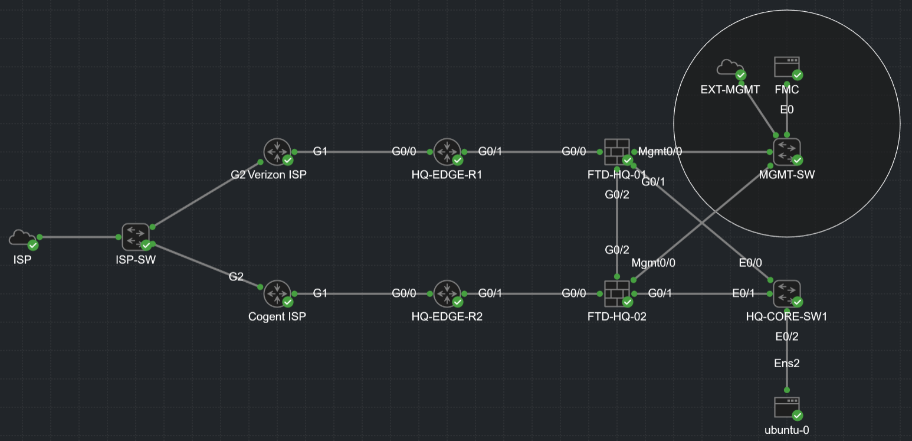

# Cisco FTD + FMC Enterprise Security Lab

Multi-site Firepower lab built in Cisco Modeling Labs.  
Two FTD firewalls managed by a single FMC — access control policy, IPS, URL filtering, NAT, and full event analysis.

---

---

## Overview

Enterprise-grade Firepower lab covering the full security policy stack from day-zero device bootstrap through active threat inspection and centralized event analysis.

Two FTD firewalls sit behind simulated ISP edge routers, both registered to a single FMC instance. All policy — access control, IPS, URL filtering, NAT — is pushed from FMC and validated against live test traffic.

## Lab Components

| Device | Role |
|--------|------|
| FMC-HQ | Centralized management — policy, logging, dashboards |
| FTD-HQ-01 | Primary perimeter firewall (WAN path 1) |
| FTD-HQ-02 | Secondary firewall / HA-ready (WAN path 2) |
| HQ-EDGE-R1/R2 | Simulated ISP edge routers with BGP |
| HQ-CORE-SW1 | Inside LAN switch |
| ubuntu-0 | Test client — traffic generation and validation |

## What's Covered

**Day-zero setup**  
FTD management interface configuration, DNS/NTP, FMC registration via CLI and JSON bootstrap files.

**Access Control Policy**  
Explicit allow/block rules, application-layer filtering, URL category blocking (gambling, adult content, malware sites), IPS integration with Balanced Security and Connectivity baseline. Default deny.

**NAT**  
Dynamic PAT for inside-to-outside traffic, optional static NAT for published services, identity NAT for VPN/DMZ paths. All translations visible in FMC connection and NAT event logs.

**IPS and URL Filtering**  
Snort 3 intrusion policy applied inline, URL categories enforced, events visible under Analysis → Intrusion and Analysis → URL.

**Testing and Verification**  
Traffic generation scripts, packet capture cheat sheet, FMC event analysis workflow. End-to-end validation from test client through FTD to simulated internet.

## Documentation

| File | Contents |
|------|----------|
| [01-overview.md](docs/01-overview.md) | Lab goals and scope |
| [02-lab-architecture.md](docs/02-lab-architecture.md) | Topology, components, network design |
| [03-ftd-day0-setup.md](docs/03-ftd-day0-setup.md) | First-boot configuration |
| [04-fmc-setup-and-registration.md](docs/04-fmc-setup-and-registration.md) | FMC initial setup and device registration |
| [05-access-control-policy.md](docs/05-access-control-policy.md) | ACP rules and IPS integration |
| [06-nat-configuration.md](docs/06-nat-configuration.md) | Dynamic PAT, static NAT, identity NAT |
| [07-testing-and-event-analysis.md](docs/07-testing-and-event-analysis.md) | Traffic generation and FMC event validation |
| [08-troubleshooting.md](docs/08-troubleshooting.md) | Common issues and fixes |
| [09-device-inventory.md](docs/09-device-inventory.md) | Full device specs and interface table |
| [10-how-to-reproduce-this-lab.md](docs/10-how-to-reproduce-this-lab.md) | Step-by-step reproduction guide |

## Platform

Built and tested on Cisco Modeling Labs (CML). Compatible with any hypervisor supporting FTD and FMC virtual appliances (Proxmox, VMware, EVE-NG).

---

[securebytes.net](https://securebytes.net) · [project page](https://securebytes.net/projects/cisco-ftd-fmc-lab/)
